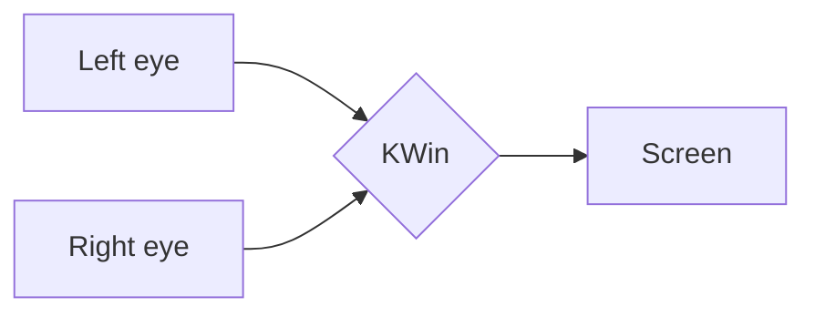

# Katemark proof document

The first paragraph, with **bold** text. Line numbers matter for scroll sync.

## A table

| Name | Eyes | Depth |
|------|-----:|:-----:|
| alpha | 2 | sunk |
| beta | 2 | screen |
| gamma | 2 | popped |

## A Mermaid diagram

## A KaTeX formula

Inline: $E = mc^2$ and a block:

$$
\int_0^\infty e^{-x^2}\,dx = \frac{\sqrt{\pi}}{2}
$$

### Filler section 1

Paragraph 1 of the filler text that makes the document taller than the window so that scrolling the editor has to move the preview. Paragraph 1 of the filler text that makes the document taller than the window so that scrolling the editor has to move the preview. 

### Filler section 2

Paragraph 2 of the filler text that makes the document taller than the window so that scrolling the editor has to move the preview. Paragraph 2 of the filler text that makes the document taller than the window so that scrolling the editor has to move the preview. 

### Filler section 3

Paragraph 3 of the filler text that makes the document taller than the window so that scrolling the editor has to move the preview. Paragraph 3 of the filler text that makes the document taller than the window so that scrolling the editor has to move the preview. 

### Filler section 4

Paragraph 4 of the filler text that makes the document taller than the window so that scrolling the editor has to move the preview. Paragraph 4 of the filler text that makes the document taller than the window so that scrolling the editor has to move the preview. 

### Filler section 5

Paragraph 5 of the filler text that makes the document taller than the window so that scrolling the editor has to move the preview. Paragraph 5 of the filler text that makes the document taller than the window so that scrolling the editor has to move the preview. 

### Filler section 6

Paragraph 6 of the filler text that makes the document taller than the window so that scrolling the editor has to move the preview. Paragraph 6 of the filler text that makes the document taller than the window so that scrolling the editor has to move the preview. 

### Filler section 7

Paragraph 7 of the filler text that makes the document taller than the window so that scrolling the editor has to move the preview. Paragraph 7 of the filler text that makes the document taller than the window so that scrolling the editor has to move the preview. 

### Filler section 8

Paragraph 8 of the filler text that makes the document taller than the window so that scrolling the editor has to move the preview. Paragraph 8 of the filler text that makes the document taller than the window so that scrolling the editor has to move the preview. 

### Filler section 9

Paragraph 9 of the filler text that makes the document taller than the window so that scrolling the editor has to move the preview. Paragraph 9 of the filler text that makes the document taller than the window so that scrolling the editor has to move the preview. 

### Filler section 10

Paragraph 10 of the filler text that makes the document taller than the window so that scrolling the editor has to move the preview. Paragraph 10 of the filler text that makes the document taller than the window so that scrolling the editor has to move the preview. 

### Filler section 11

Paragraph 11 of the filler text that makes the document taller than the window so that scrolling the editor has to move the preview. Paragraph 11 of the filler text that makes the document taller than the window so that scrolling the editor has to move the preview. 

### Filler section 12

Paragraph 12 of the filler text that makes the document taller than the window so that scrolling the editor has to move the preview. Paragraph 12 of the filler text that makes the document taller than the window so that scrolling the editor has to move the preview. 

### Filler section 13

Paragraph 13 of the filler text that makes the document taller than the window so that scrolling the editor has to move the preview. Paragraph 13 of the filler text that makes the document taller than the window so that scrolling the editor has to move the preview. 

### Filler section 14

Paragraph 14 of the filler text that makes the document taller than the window so that scrolling the editor has to move the preview. Paragraph 14 of the filler text that makes the document taller than the window so that scrolling the editor has to move the preview. 

### Filler section 15

Paragraph 15 of the filler text that makes the document taller than the window so that scrolling the editor has to move the preview. Paragraph 15 of the filler text that makes the document taller than the window so that scrolling the editor has to move the preview. 

### Filler section 16

Paragraph 16 of the filler text that makes the document taller than the window so that scrolling the editor has to move the preview. Paragraph 16 of the filler text that makes the document taller than the window so that scrolling the editor has to move the preview. 

### Filler section 17

Paragraph 17 of the filler text that makes the document taller than the window so that scrolling the editor has to move the preview. Paragraph 17 of the filler text that makes the document taller than the window so that scrolling the editor has to move the preview. 

### Filler section 18

Paragraph 18 of the filler text that makes the document taller than the window so that scrolling the editor has to move the preview. Paragraph 18 of the filler text that makes the document taller than the window so that scrolling the editor has to move the preview. 

### Filler section 19

Paragraph 19 of the filler text that makes the document taller than the window so that scrolling the editor has to move the preview. Paragraph 19 of the filler text that makes the document taller than the window so that scrolling the editor has to move the preview. 

### Filler section 20

Paragraph 20 of the filler text that makes the document taller than the window so that scrolling the editor has to move the preview. Paragraph 20 of the filler text that makes the document taller than the window so that scrolling the editor has to move the preview. 

### Filler section 21

Paragraph 21 of the filler text that makes the document taller than the window so that scrolling the editor has to move the preview. Paragraph 21 of the filler text that makes the document taller than the window so that scrolling the editor has to move the preview. 

### Filler section 22

Paragraph 22 of the filler text that makes the document taller than the window so that scrolling the editor has to move the preview. Paragraph 22 of the filler text that makes the document taller than the window so that scrolling the editor has to move the preview. 

### Filler section 23

Paragraph 23 of the filler text that makes the document taller than the window so that scrolling the editor has to move the preview. Paragraph 23 of the filler text that makes the document taller than the window so that scrolling the editor has to move the preview. 

### Filler section 24

Paragraph 24 of the filler text that makes the document taller than the window so that scrolling the editor has to move the preview. Paragraph 24 of the filler text that makes the document taller than the window so that scrolling the editor has to move the preview. 

### Filler section 25

Paragraph 25 of the filler text that makes the document taller than the window so that scrolling the editor has to move the preview. Paragraph 25 of the filler text that makes the document taller than the window so that scrolling the editor has to move the preview. 

### Filler section 26

Paragraph 26 of the filler text that makes the document taller than the window so that scrolling the editor has to move the preview. Paragraph 26 of the filler text that makes the document taller than the window so that scrolling the editor has to move the preview. 

### Filler section 27

Paragraph 27 of the filler text that makes the document taller than the window so that scrolling the editor has to move the preview. Paragraph 27 of the filler text that makes the document taller than the window so that scrolling the editor has to move the preview. 

### Filler section 28

Paragraph 28 of the filler text that makes the document taller than the window so that scrolling the editor has to move the preview. Paragraph 28 of the filler text that makes the document taller than the window so that scrolling the editor has to move the preview. 

### Filler section 29

Paragraph 29 of the filler text that makes the document taller than the window so that scrolling the editor has to move the preview. Paragraph 29 of the filler text that makes the document taller than the window so that scrolling the editor has to move the preview. 

### Filler section 30

Paragraph 30 of the filler text that makes the document taller than the window so that scrolling the editor has to move the preview. Paragraph 30 of the filler text that makes the document taller than the window so that scrolling the editor has to move the preview. 

### Filler section 31

Paragraph 31 of the filler text that makes the document taller than the window so that scrolling the editor has to move the preview. Paragraph 31 of the filler text that makes the document taller than the window so that scrolling the editor has to move the preview. 

### Filler section 32

Paragraph 32 of the filler text that makes the document taller than the window so that scrolling the editor has to move the preview. Paragraph 32 of the filler text that makes the document taller than the window so that scrolling the editor has to move the preview. 

### Filler section 33

Paragraph 33 of the filler text that makes the document taller than the window so that scrolling the editor has to move the preview. Paragraph 33 of the filler text that makes the document taller than the window so that scrolling the editor has to move the preview. 

### Filler section 34

Paragraph 34 of the filler text that makes the document taller than the window so that scrolling the editor has to move the preview. Paragraph 34 of the filler text that makes the document taller than the window so that scrolling the editor has to move the preview. 

### Filler section 35

Paragraph 35 of the filler text that makes the document taller than the window so that scrolling the editor has to move the preview. Paragraph 35 of the filler text that makes the document taller than the window so that scrolling the editor has to move the preview. 

### Filler section 36

Paragraph 36 of the filler text that makes the document taller than the window so that scrolling the editor has to move the preview. Paragraph 36 of the filler text that makes the document taller than the window so that scrolling the editor has to move the preview. 

### Filler section 37

Paragraph 37 of the filler text that makes the document taller than the window so that scrolling the editor has to move the preview. Paragraph 37 of the filler text that makes the document taller than the window so that scrolling the editor has to move the preview. 

### Filler section 38

Paragraph 38 of the filler text that makes the document taller than the window so that scrolling the editor has to move the preview. Paragraph 38 of the filler text that makes the document taller than the window so that scrolling the editor has to move the preview. 

### Filler section 39

Paragraph 39 of the filler text that makes the document taller than the window so that scrolling the editor has to move the preview. Paragraph 39 of the filler text that makes the document taller than the window so that scrolling the editor has to move the preview. 

### Filler section 40

Paragraph 40 of the filler text that makes the document taller than the window so that scrolling the editor has to move the preview. Paragraph 40 of the filler text that makes the document taller than the window so that scrolling the editor has to move the preview. 

## The last heading

END-OF-DOCUMENT-MARKER
